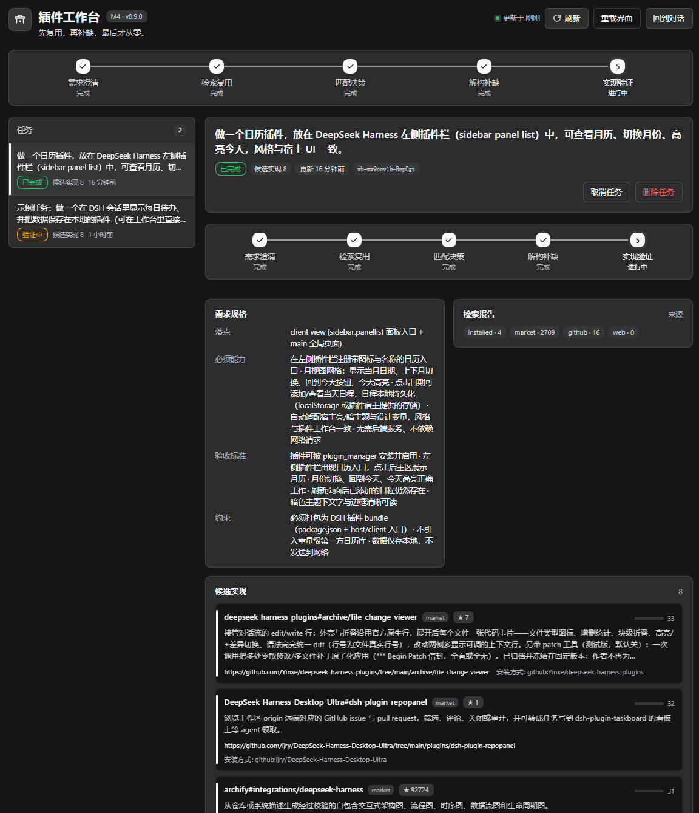
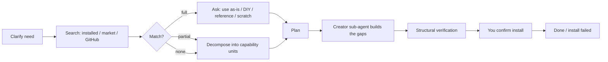

# dsh-plugin-workbench

[中文说明](README.zh.md) · [Changelog](CHANGELOG.md) · [Market entry](market-entry.yml)

A **reuse-first plugin authoring workbench** for [DeepSeek Harness (DSH)](https://github.com/deepseek-ai/deepseek-harness).

Instead of letting the agent start writing plugin code immediately, the workbench first asks *"does this need a new plugin at all?"* — it clarifies the requirement, searches installed plugins, the DSH market catalog and GitHub for something reusable, asks you how to proceed, and only then builds the remaining gaps in an isolated sub-agent. Every step stays visible in a page in the DSH sidebar, and verification happens before anything is installed.



## Why

Most "make me a plugin" requests end up recreating something that already exists. The workbench makes **checking for an existing implementation the default path**, and keeps the expensive model work (searching, reading repositories, generating code) out of your main conversation:

- retrieval and ranking run in the Host, not in the model context;
- generation runs in a Creator sub-agent, so the parent conversation only receives a summary;
- nothing is installed silently — you confirm every install.

## Features

- **Clarify** a free-form need into a structured spec (surface, must-have capabilities, acceptance criteria, constraints).
- **Search & reuse** in four ladders: installed plugins → curated market catalog → GitHub repositories → repository details.
- **Decide** with a four-way choice: use as-is, DIY on top, reference only, or build from scratch.
- **Decompose** partial matches into capability units with a reuse source or a gap for each unit.
- **Hand off** gaps to a Creator sub-agent (the `cordis` preset) in its own context.
- **Verify** the generated bundle structurally — manifest, patch, client entry, locale, icon and JavaScript syntax — without executing it.
- **Record** the install result, so the task ends with a clear `done` / `install_failed` state.
- **Workbench page** in the sidebar: task list, five-stage rail, spec, candidates, search report, decision, units, handoff and verification cards.

## Install

Requirements: a DSH profile with the Web UI (**dsh >= 0.2.1-rc.2**, tested on `0.2.2-rc.1`), Node.js 22.19+ or 24+.

**From GitHub** (works before the npm/market release):

```sh
dsh plugin --profile <profile> add github:lixian292/dsh-plugin-workbench
```

**From npm** (once the scoped package is published):

```sh
dsh plugin --profile <profile> add @lixian292/dsh-plugin-workbench
```

**From a local checkout** (development): in the DSH Plugins page, install the local bundle by absolute path, e.g. through the `plugin_manager` tool with `install_bundle`.

After installing, open the sidebar and click **Plugin Workbench**. It sits next to *Plugins*, *Market* and *Context insights*.

> The package is published under the scoped name `@lixian292/dsh-plugin-workbench` because the unscoped name already belonged to an unrelated, discontinued plugin.

## Quick start

1. Open **Plugin Workbench** from the sidebar (the page can stay open while you chat).
2. In any DSH conversation, describe the plugin you want, for example:
   > Build a plugin that adds a calendar panel to the DSH sidebar: month view, switch months, highlight today, and keep events locally.
3. The agent loads the `plugin-workbench` skill and walks the pipeline: **start → clarify → search → decide**.
4. When candidates are found, you get a four-way choice: **Use as-is / DIY on top / Reference only / From scratch**.
5. For reuse or partial matches it records the capability units and gaps, then hands the gaps to a Creator sub-agent.
6. The page updates automatically: candidates, the search report, the decision, the plan, verification checks and the install result.

Useful prompts:

- *"Is there already a DSH plugin that does X? Use the workbench."*
- *"Build a plugin for X, but first check what already exists."*
- *"Use the plugin workbench to do this."*

## How it works



| Stage | What the Host does |
|---|---|
| Clarify | stores a structured spec on the task |
| Search | queries installed plugins, the cached market catalog and GitHub, ranks candidates locally |
| Decide | records your four-way choice |
| Decompose | stores capability units (`reuse` or `gap`) |
| Handoff | `install` returns an exact package spec; `fork`/`create` start a Creator sub-agent |
| Verify | checks bundle structure and runs `node --check`; never executes generated code |
| Record install | stores the `application` value from `plugin_manager` and finishes the task |

## Configuration

### Optional GitHub token

Anonymous GitHub search is limited to about 10 requests per minute. A read-only token raises the quota to 30 requests per minute. Resolution order:

1. environment variables `DSH_GITHUB_TOKEN`, `DSH_PLUGIN_WORKBENCH_GITHUB_TOKEN`, or `GITHUB_TOKEN`;
2. `$DSH_HOME/plugin-workbench/github-token.txt` or `github_token.txt`;
3. the workspace directory's `github-token.txt` or `github_token.txt`.

The first line of the file is the token. Never commit it — both file names are in `.gitignore`. The token is only attached to GitHub API requests from the Host; it never appears in task state, the page API, logs or the model context. Tool results report `githubAuth: "token" | "anonymous"`.

### Data and privacy

- Task state: `$DSH_HOME/plugin-workbench/state.json`
- Market catalog cache: `$DSH_HOME/plugin-workbench/cache/market.json` (refreshed daily)
- The workbench page talks to the Host over the same-origin `POST /workbench/api`; cross-origin requests are rejected
- Nothing is collected or uploaded by the plugin itself; the only network calls are the configured search/fetch services and GitHub.

## Commands

| Command | Purpose |
|---|---|
| `/workbench` | show the latest task and stage |
| `/workbench list` | list tasks |

The agent-facing tool is `plugin_workbench` with actions: `start`, `update_spec`, `search`, `get_report`, `record_decision`, `set_decomposition`, `handoff`, `verify`, `record_install`, `status`, `cancel`. The matching skill is `plugin-workbench` and is loaded on demand.

## Development

Plain JavaScript, no build step. The browser half is loaded through `window.__ModuleLoader__.load({ id, factory })`; styles use `--dsw-alias-*` theme tokens only.

```sh
npm run check   # node --check every JS file + validate JSON
npm test        # zero-dependency test suite (node --test)
```

Repository layout:

```
index.js            host entry (re-exports host/index.js)
host/               host half: store, search adapters, market cache, handoff, verify, page API
client.js           browser half: sidebar entry + workbench page
locale/             plugin metadata (zh/en)
assets/             icon and screenshots
scripts/            repository checks + market submission helper
test/               node:test suite
```

CI runs `check` and `test` on Node 22 and 24 (`.github/workflows/ci.yml`).

## Compatibility and limitations

- Designed for the DSH Web GUI; there is no CLI-only mode.
- The page is a local tool: one workbench state per DSH home, not a team service.
- Installation is always user-confirmed; the workbench never installs silently.
- Marketplace listing is pending: the registry requires the repository to be at least 24 hours old.
- The `verify` action checks structure only; it is not a security review of generated code.

## Contributing

Issues and pull requests are welcome. For a new plugin submission to the DSH ecosystem, see [`market-entry.yml`](market-entry.yml) and `scripts/submit-market.mjs`.

## License

MIT — see [LICENSE](LICENSE).
