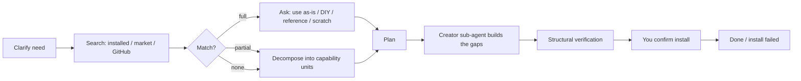

# dsh-plugcraft

  

[中文说明](README.zh.md) · [Changelog](CHANGELOG.md) · [Market entry](market-entry.yml)

**Plugcraft** is a **reuse-first plugin authoring workbench** for [DeepSeek Harness (DSH)](https://github.com/deepseek-ai/deepseek-harness).

Instead of letting the agent start writing plugin code immediately, the workbench first asks *"does this need a new plugin at all?"* — it clarifies the requirement, searches installed plugins, the DSH market catalog and GitHub for something reusable, asks you how to proceed, and only then builds the remaining gaps in an isolated sub-agent. Every step stays visible in a page in the DSH sidebar, and verification happens before anything is installed.

> **Search first, build last.** Find a reusable implementation, let you decide how to reuse it, and verify anything generated before it reaches your profile.

## Screenshots


| Candidates | Plan & handoff | The plugin it produced |
|---|---|---|
|  |  |  |

The screenshots follow one task end to end: a calendar-plugin request, eight reusable candidates found across the market and GitHub, the decomposition into capability units, the verification checks, and the installed calendar plugin.

## What the page gives you

- **Task cards in one vertical list** — each plugin need is a card showing goal, stage, candidate count and last update. Click a card to expand its full detail in place; click again to collapse it. Only one task is open at a time, so the page stays short.
- **A five-step progress stepper** in the expanded card header: clarify → search → decide → decompose → build, with a smooth fill to the current node.
- **Three tabs** inside the expanded card:
  - **Overview** — spec, search report, decision, capability-unit summary and handoff summary in one screen.
  - **Candidates** — reusable implementations found across installed plugins, the market catalog and GitHub; five rows by default with a “show all” toggle.
  - **Plan & handoff** — install spec, Creator sub-agent status, structural verification checks and the final install result.

Everything refreshes automatically every few seconds; there is no submit button to forget.

## Why Plugcraft?

Most "make me a plugin" requests end up recreating something that already exists. Plugcraft makes **checking for an existing implementation the default path**, and keeps the expensive model work out of your main conversation:

- **Search is the first step, not an afterthought.** Four reuse ladders: installed plugins → curated market catalog → GitHub repositories → repository details.
- **You make the call.** A four-way decision — use as-is, DIY on top, reference only, or from scratch — belongs to the user, not the model.
- **The parent conversation stays small.** Retrieval and ranking run in the Host; generation runs in a Creator sub-agent that returns a summary.
- **Nothing installs unverified or silently.** Generated bundles pass structural checks first; every install is confirmed by you and recorded on the task.

## Features

- **Clarify** a free-form need into a structured spec (surface, must-have capabilities, acceptance criteria, constraints).
- **Search & reuse** in four ladders: installed plugins → curated market catalog → GitHub repositories → repository details.
- **Decide** with a four-way choice: use as-is, DIY on top, reference only, or build from scratch.
- **Decompose** partial matches into capability units with a reuse source or a gap for each unit.
- **Hand off** gaps to a Creator sub-agent (the `cordis` preset) in its own context.
- **Verify** the generated bundle structurally — manifest, patch, client entry, locale, icon and JavaScript syntax — without executing it.
- **Record** the install result, so the task ends with a clear `done` / `install_failed` state.
- **Workbench page** in the sidebar: expandable task cards, in-card five-step progress, spec, candidates, search report, decision, units, handoff and verification cards.

## Install

Requirements: a DSH profile with the Web UI (**dsh >= 0.2.1-rc.2**, tested on `0.2.2-rc.1`), Node.js 22.19+ or 24+.

**From GitHub** (recommended until the first npm release):

```sh
dsh plugin --profile <profile> add github:lixian292/dsh-plugcraft
```

**From a release tarball** (no registry account needed): download the `.tgz` from the [latest release](https://github.com/lixian292/dsh-plugcraft/releases/latest) and install it:

```sh
dsh plugin --profile <profile> add <path-or-url-to>/dsh-plugcraft-<version>.tgz
```

**From a local checkout** (development): in the DSH Plugins page, install the local bundle by absolute path, e.g. through the `plugin_manager` tool with `install_bundle`.

After installing, open the sidebar and click **Plugcraft** (Chinese UI: 插件工作台). It sits next to *Plugins*, *Market* and *Context insights*.

> An npm package (`dsh-plugcraft`) is planned; npm registration was unavailable when the first release was cut, so GitHub and release tarballs are the supported channels for now.

## Quick start

1. **Open Plugcraft** from the sidebar. Leave the page open while you chat.
2. **Describe the plugin** in any DSH conversation, for example:
   > Build a plugin that adds a calendar panel to the DSH sidebar: month view, switch months, highlight today, and keep events locally.
3. **Let the pipeline run.** The agent loads the `plugin-workbench` skill and calls `plugin_workbench` — the page fills in with the spec, search results and stage.
4. **Answer one question.** When candidates exist you get four choices: **Use as-is / DIY on top / Reference only / From scratch**.
5. **Follow the plan.** For reuse or partial matches it records capability units and gaps, hands the gaps to a Creator sub-agent, and verifies the generated bundle before asking you to install.
6. **Check the result.** The page shows verification checks and the install result; nothing is installed silently.

Useful prompts:

- *"Is there already a DSH plugin that does X? Use the workbench."*
- *"Build a plugin for X, but first check what already exists."*
- *"Use the plugin workbench to do this."*

## How it works



| Stage | What the Host does |
|---|---|
| Clarify | stores a structured spec on the task |
| Search | queries installed plugins, the cached market catalog and GitHub, ranks candidates locally |
| Decide | records your four-way choice |
| Decompose | stores capability units (`reuse` or `gap`) |
| Handoff | `install` returns an exact package spec; `fork`/`create` start a Creator sub-agent |
| Verify | checks bundle structure and runs `node --check`; never executes generated code |
| Record install | stores the `application` value from `plugin_manager` and finishes the task |

## Configuration

### Optional GitHub token

Anonymous GitHub search is limited to about 10 requests per minute. A read-only token raises the quota to 30 requests per minute. Resolution order:

1. environment variables `DSH_GITHUB_TOKEN`, `DSH_PLUGIN_WORKBENCH_GITHUB_TOKEN`, or `GITHUB_TOKEN`;
2. `$DSH_HOME/plugin-workbench/github-token.txt` or `github_token.txt`;
3. the workspace directory's `github-token.txt` or `github_token.txt`.

The first line of the file is the token. Never commit it — both file names are in `.gitignore`. The token is only attached to GitHub API requests from the Host; it never appears in task state, the page API, logs or the model context. Tool results report `githubAuth: "token" | "anonymous"`.

### Data and privacy

- Task state: `$DSH_HOME/plugin-workbench/state.json`
- Market catalog cache: `$DSH_HOME/plugin-workbench/cache/market.json` (refreshed daily)
- The workbench page talks to the Host over the same-origin `POST /workbench/api`; cross-origin requests are rejected
- Nothing is collected or uploaded by the plugin itself; the only network calls are the configured search/fetch services and GitHub.

## Commands

| Command | Purpose |
|---|---|
| `/workbench` | show the latest task and stage |
| `/workbench list` | list tasks |

The agent-facing tool is `plugin_workbench` with actions: `start`, `update_spec`, `search`, `get_report`, `record_decision`, `set_decomposition`, `handoff`, `verify`, `record_install`, `status`, `cancel`. The matching skill is `plugin-workbench` and is loaded on demand.

## Troubleshooting

| Symptom | Fix |
|---|---|
| The page says **“failed to load / HTTP 405”** | The page is talking to an older Host generation. Use **Reload UI** in the page header, or hard-reload the window (`Ctrl+Shift+R`). Restart DSH if it persists. |
| No **Plugcraft** entry in the sidebar | Reinstall the bundle (see Install), then reload the page. The entry is registered by the browser half. |
| The page is empty but the chat already created a plugin | The agent must call `plugin_workbench` to create a task. Ask it to use the workbench explicitly: *“Use the plugin workbench for this.”* |
| Search returns no candidates | Add a GitHub token (see below); anonymous search is rate-limited. Installed plugins and the cached market catalog are still searched without a token. |
| The skill refuses to load | Reinstall the bundle; a stale client or Host generation is the usual cause. |

## FAQ

**Does it install plugins without asking me?**
No. `handoff` either returns an install spec for the approval-gated `plugin_manager` tool, or starts a Creator sub-agent. Installation always needs your explicit confirmation, and the result is recorded on the task.

**Why plain JavaScript instead of TypeScript?**
The shipped artifact is readable, dependency-free JavaScript: no build step, no bundled toolchain, easy to audit in the marketplace review. The trade-off is no compile-time type checking of Harness APIs, so the repo relies on `node --check`, the test suite and structural verification. If the UI grows much further, moving the browser half to TypeScript with a bundler would be the natural next step; the Host half is small enough to stay plain JS.

**Where is the data stored?**
`$DSH_HOME/plugin-workbench/`. See Configuration above.

## Development

Plain JavaScript, no build step. The browser half is loaded through `window.__ModuleLoader__.load({ id, factory })`; styles use `--dsw-alias-*` theme tokens only.

```sh
npm run check   # node --check every JS file + validate JSON
npm test        # zero-dependency test suite (node --test)
```

Repository layout:

```
index.js            host entry (re-exports host/index.js)
host/               host half: store, search adapters, market cache, handoff, verify, page API
client.js           browser half: sidebar entry + workbench page
locale/             plugin metadata (zh/en)
assets/             icon and screenshots
scripts/            repository checks + market submission helper
test/               node:test suite
```

CI runs `check` and `test` on Node 22 and 24 (`.github/workflows/ci.yml`).

## Compatibility and limitations

- Designed for the DSH Web GUI; there is no CLI-only mode.
- The page is a local tool: one workbench state per DSH home, not a team service.
- Installation is always user-confirmed; the workbench never installs silently.
- Marketplace listing is pending: the registry requires the repository to be at least 24 hours old.
- The `verify` action checks structure only; it is not a security review of generated code.

## Contributing

Issues and pull requests are welcome. For a new plugin submission to the DSH ecosystem, see [`market-entry.yml`](market-entry.yml) and `scripts/submit-market.mjs`.

## License

MIT — see [LICENSE](LICENSE).
