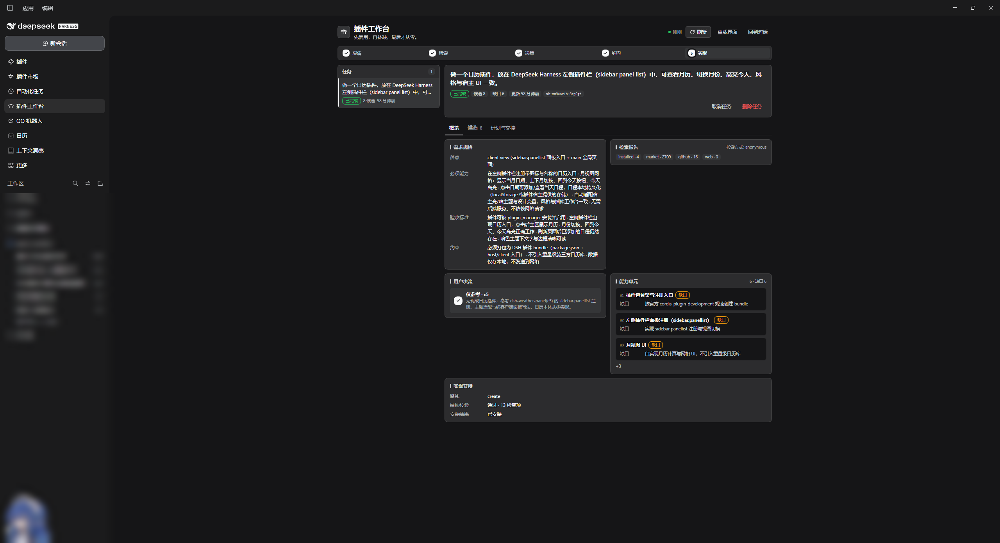
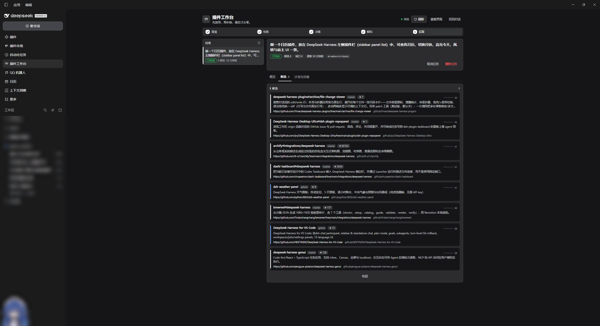
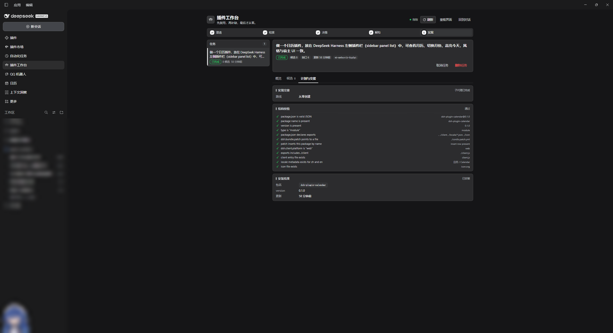
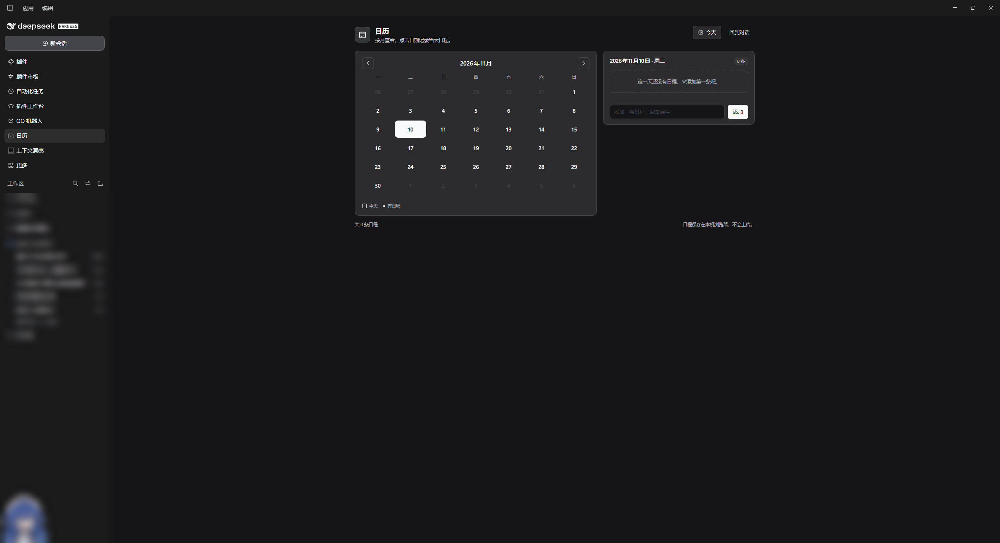
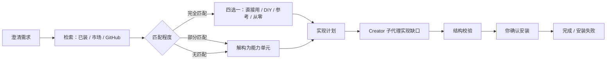

# dsh-plugcraft

  

[English](README.md) · [更新日志](CHANGELOG.md) · [市场条目](market-entry.yml)

**Plugcraft（插件工坊）** 是 **复用优先的插件创作工作台**，为 [DeepSeek Harness（DSH）](https://github.com/deepseek-ai/deepseek-harness) 而做。

它不会让 Agent 一上来就写插件代码，而是先回答一个问题：**这个需求真的需要新写一个插件吗？** 工作台会先澄清需求，依次检索本机已装插件、DSH 市场目录和 GitHub 里的现成实现，让你选择复用方式，最后才把真正缺失的部分交给独立子代理实现。整个过程显示在 DSH 侧栏的页面里，安装前还会做结构校验。

> **先检索，再动手。** 先找可复用的实现，由你决定复用方式，生成的内容在进入 profile 之前必须通过校验。

## 截图



| 候选实现 | 计划与交接 | 最终产出的插件 |
|---|---|---|
|  |  |  |

四张截图来自同一条任务：一个日历插件需求，在市场与 GitHub 中检索到 8 个可复用候选，解构为能力单元，经过结构校验后安装出来的日历插件。

## 页面能给你什么

- 左侧是**任务列表**：一个插件需求一行，显示阶段与候选数量。
- 详情上方是一条**紧凑的五步进度条**：澄清 → 检索 → 决策 → 解构 → 实现。
- 详情分 **三个 Tab**：
  - **概览**：需求规格、检索报告、用户决策、能力单元摘要、交接摘要，一屏看完；
  - **候选**：本机已装 / 市场 / GitHub 找到的可复用实现，默认显示 5 条，可展开全部；
  - **计划与交接**：安装 spec、Creator 子代理状态、结构校验结果与最终安装结果。

页面每几秒自动刷新，不需要手动提交。

## 为什么是 Plugcraft？

大多数「帮我写个插件」的请求，最后都在重造一个已经存在的东西。Plugcraft 把**先找现成实现**变成默认路径，并把昂贵的模型工作移出主会话：

- **检索是第一步，而不是补丁。** 四级复用阶梯：本机已装插件 → 精选市场目录 → GitHub 仓库 → 仓库详情。
- **决策权在你。** 直接使用 / 基于它 DIY / 仅参考 / 从零开始，四选一由用户决定，而不是模型替你决定。
- **主会话不会被检索拖重。** 检索与排序在 Host 侧完成；生成交给 Creator 子代理，父会话只收摘要。
- **不验证不安装。** 生成包先过结构校验；每次安装都由你确认，并回写到任务记录。

## 功能

- **澄清**：把一句话需求整理成结构化规格（落点、必须能力、验收标准、约束）。
- **检索复用**：本机已装插件 → 市场目录 → GitHub 仓库 → 仓库详情，四级检索。
- **四选一决策**：直接使用 / 基于它 DIY / 仅参考 / 从零开始。
- **解构缺口**：部分匹配时拆成能力单元，每个单元标注复用来源或缺口。
- **实现交接**：缺口交给 `cordis` 预设的 Creator 子代理，在自己的上下文里实现。
- **结构校验**：不执行生成代码，检查 manifest、patch、client 入口、locale、图标与 JS 语法。
- **安装闭环**：回写 `plugin_manager` 返回的安装结果，任务以 `done` / `install_failed` 收尾。
- **工作台页面**：任务列表、五段式阶段轨道、需求规格、候选实现、检索报告、决策、能力单元、交接与校验卡片。

## 安装

前置条件：带 Web UI 的 DSH 配置（**dsh >= 0.2.1-rc.2**，已在 `0.2.2-rc.1` 实测），Node.js 22.19+ 或 24+。

**从 GitHub 安装**（首个 npm 版本发布前推荐）：

```sh
dsh plugin --profile <profile> add github:lixian292/dsh-plugcraft
```

**从 Release 压缩包安装**（不需要任何账号）：从 [最新 Release](https://github.com/lixian292/dsh-plugcraft/releases/latest) 下载 `.tgz` 后安装：

```sh
dsh plugin --profile <profile> add <压缩包路径或链接>/dsh-plugcraft-<version>.tgz
```

**本地开发**：在 DSH 插件页按绝对路径安装本地 bundle，或通过 `plugin_manager` 工具执行 `install_bundle`。

安装后打开左侧栏，点击 **插件工坊**（英文界面为 **Plugcraft**）；它与「插件」「插件市场」「上下文洞察」同组。

> npm 包（`dsh-plugcraft`）计划中；首次发布时 npm 注册不可用，因此现阶段以 GitHub 和 Release 压缩包为安装渠道。

## 快速上手

1. **打开插件工坊**（侧栏入口），页面可以一直开着，不影响对话。
2. **在任意 DSH 会话里描述插件需求**，例如：
   > 做一个日历插件，放在 DSH 左侧插件栏里，可以查看月历、切换月份、高亮今天，日程保存在本地。
3. **让流程跑起来**：Agent 会加载 `plugin-workbench` 技能并调用 `plugin_workbench`，页面会逐步出现需求规格、检索结果和当前阶段。
4. **回答一次问题**：找到候选后，你会收到四选一：**直接使用 / 基于它 DIY / 仅参考 / 从零开始**。
5. **跟着计划走**：部分匹配时会记录能力单元与缺口，把缺口交给 Creator 子代理，并在安装前做结构校验。
6. **查看结果**：页面显示校验结果与安装结果；安装永远需要你确认。

常用说法：

- 「DSH 里有没有现成插件能做 X？用工作台查一下。」
- 「帮我做一个 X 插件，先看看社区里有没有现成的。」
- 「用插件工作台做这个。」

## 工作流



| 阶段 | Host 做什么 |
|---|---|
| 澄清 | 在任务上保存结构化规格 |
| 检索 | 查询已装插件、缓存的市场目录与 GitHub，本地排序 |
| 决策 | 记录你的四选一结果 |
| 解构 | 保存能力单元（复用来源或缺口） |
| 交接 | `install` 返回精确安装 spec；`fork`/`create` 启动 Creator 子代理 |
| 校验 | 检查 bundle 结构并运行 `node --check`，不执行生成代码 |
| 回写安装 | 保存 `plugin_manager` 的 `application`，结束任务 |

## 配置

### 可选 GitHub token

匿名 GitHub 检索限制约 10 次/分钟；只读 token 可提升到 30 次/分钟。解析顺序：

1. 环境变量 `DSH_GITHUB_TOKEN` / `DSH_PLUGIN_WORKBENCH_GITHUB_TOKEN` / `GITHUB_TOKEN`；
2. `$DSH_HOME/plugin-workbench/github-token.txt` 或 `github_token.txt`；
3. 工作区目录下的 `github-token.txt` 或 `github_token.txt`。

文件第一行即 token，**不要提交到 git**（两个文件名都在 `.gitignore` 里）。token 只用于 Host 的 GitHub API 请求，不会进入任务状态、页面 API、日志或模型上下文。工具返回会报告 `githubAuth: "token" | "anonymous"`。

### 数据与隐私

- 任务状态：`$DSH_HOME/plugin-workbench/state.json`
- 市场目录缓存：`$DSH_HOME/plugin-workbench/cache/market.json`（每日刷新）
- 页面通过同源 `POST /workbench/api` 与 Host 通信，跨源请求会被拒绝
- 插件自身不收集、不上传任何数据；网络请求只发往已配置的检索/抓取服务和 GitHub

## 命令

| 命令 | 作用 |
|---|---|
| `/workbench` | 查看最新任务与阶段 |
| `/workbench list` | 列出任务 |

面向 Agent 的工具是 `plugin_workbench`，动作包括：`start`、`update_spec`、`search`、`get_report`、`record_decision`、`set_decomposition`、`handoff`、`verify`、`record_install`、`status`、`cancel`。对应技能为 `plugin-workbench`，按需加载。

## 排查

| 现象 | 处理 |
|---|---|
| 页面提示 **「读取失败 / HTTP 405」** | 页面连到了旧的 Host 代际。点页头的 **重载界面**，或硬刷新（Ctrl+Shift+R）；仍不行就重启 DSH。 |
| 侧栏没有 **插件工坊** 入口 | 重新安装 bundle（见「安装」），然后刷新页面；入口由浏览器半边注册。 |
| 对话里已经做了插件，但页面是空的 | Agent 必须调用 `plugin_workbench` 才会创建任务。明确说「用插件工作台做这个」。 |
| 检索没有候选 | 配置 GitHub token（见下）；匿名检索有频率限制，但本机已装插件与缓存的市场目录仍会检索。 |
| 技能加载失败 | 重装 bundle；通常是客户端/Host 代际不一致导致。 |

## FAQ

**它会静默安装插件吗？**
不会。`handoff` 要么返回安装 spec 交给需要审批的 `plugin_manager` 工具，要么启动 Creator 子代理；安装永远需要你确认，结果会回写到任务里。

**为什么用纯 JavaScript，而不是 TypeScript？**
交付物是可读、零运行时依赖的 JavaScript：没有构建步骤、没有打包工具链，市场审核也更容易逐行检查。代价是没有对 Harness API 的编译期类型检查，因此仓库依赖 `node --check`、测试套件和结构校验兜底。如果 UI 继续变复杂，把浏览器半边迁到 TypeScript + 打包器会是自然的下一步；Host 半边很小，可以继续保持纯 JS。

**数据存在哪？**
`$DSH_HOME/plugin-workbench/`，见上方「配置」。

## 开发

纯 JavaScript，无需构建。浏览器半边通过 `window.__ModuleLoader__.load({ id, factory })` 加载；样式只使用 `--dsw-alias-*` 主题 token。

```sh
npm run check   # 对所有 JS 做 node --check，并校验 JSON
npm test        # 零依赖测试（node --test）
```

目录结构：

```
index.js            Host 入口（转发 host/index.js）
host/               Host 半边：存储、检索适配、市场缓存、交接、校验、页面 API
client.js           浏览器半边：侧栏入口 + 工作台页面
locale/             插件元数据（中/英）
assets/             图标与截图
scripts/            仓库检查 + 市场投稿脚本
test/               node:test 测试
```

CI 在 Node 22 / 24 上运行 `check` + `test`（`.github/workflows/ci.yml`）。

## 兼容性与限制

- 面向 DSH Web GUI，没有纯 CLI 模式。
- 页面是本地工具：一个 DSH home 一份工作台状态，不是团队服务。
- 安装永远需要用户确认，工作台不会静默安装。
- 市场收录待完成：注册表要求仓库创建满 24 小时。
- `verify` 只做结构校验，不构成对生成代码的安全审计。

## 贡献

欢迎 Issue 与 PR。向 DSH 生态提交新插件时，可参考 [`market-entry.yml`](market-entry.yml) 与 `scripts/submit-market.mjs`。

## 许可

MIT，见 [LICENSE](LICENSE)。
